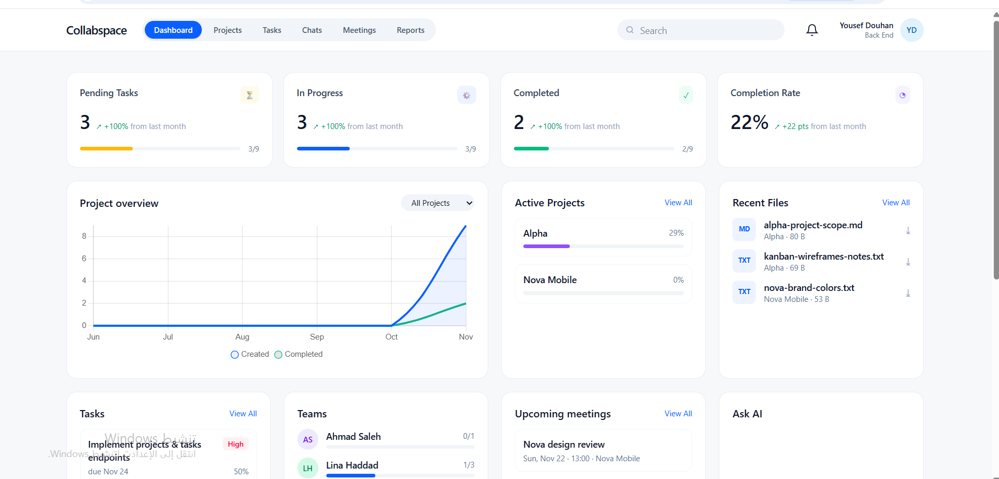
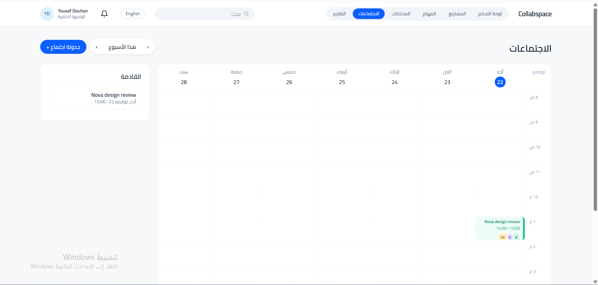
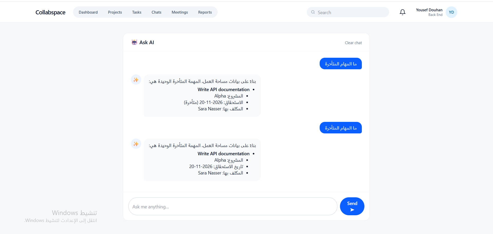

<div align="center">

# CollabSpace

**A team-collaboration workspace: projects, Kanban, chat, meetings with AI summaries, reports and an AI assistant.**

Built with Laravel 13 for the **Huma-volve CollabSpace Challenge** · Figma: *Collabpspace, Team C*


[](https://github.com/Yousef-Douhan/collabspace/actions/workflows/ci.yml)

_%7C_French-0B5FFF)

[Overview](#-overview) · [Features](#-features) · [Screenshots](#-screenshots) · [Quick start](#-quick-start) · [API](#-rest-api) · [Architecture](#-architecture) · [Testing](#-testing)



</div>

---

## 📌 Overview

CollabSpace gives a team one place to plan work, talk, meet and see progress. One Laravel codebase serves two clients:

| Client | Auth | Purpose |
|---|---|---|
| **Blade web app** | Session | The full UI from the Figma design, in English, Arabic (RTL) and French |
| **REST API** `/api/v1` | Sanctum tokens | For mobile and SPA clients. Ships with a 80-request Postman collection |

Both clients go through the **same Form Requests, Policies and Services**, so validation, permissions and business rules are defined once.

> **نبذة بالعربية:** منصة تعاون للفرق، فيها إدارة المشاريع، ولوحة مهام Kanban بالسحب والإفلات، ومحادثات مع علامات القراءة، واجتماعات بتقويم أسبوعي وملخص بالذكاء الاصطناعي، وتقارير ورسوم بيانية، ومساعد ذكي يجيب من بيانات الفريق. الواجهة كاملة بالعربية والإنجليزية والفرنسية مع دعم الكتابة من اليمين لليسار، ومعها REST API موثّق و113 اختباراً آلياً.

---

## ✨ Features

### Work management

- **Projects:** status, priority, start and deadline dates, live completion %, members with roles (owner, manager, member), and a Markdown wiki.
- **Kanban tasks:** filters by project, my tasks, overdue or due this week, and priority. Drag & drop across *To-do → In Progress → In Review → Completed*. Tasks have priorities, tracks (UI/UX, Front End, Back End, Graphic Design), assignees and a reviewer, progress, estimated hours, due dates with overdue highlighting, comments and attachments.
- **Files:** private per-project and per-task storage. Downloads are allowed only for members.

### Communication

- **Chats:** direct messages and group or project channels, attachments, editing and deleting your own messages, read receipts ✓ / ✓✓, unread counters, and pin or archive per user. Open threads update live every few seconds, with no page reload.
- **Meetings:** a weekly calendar; a *New Meeting* form with date, time and duration, guests, a note, a location, a reminder, notifications by **in-app, email or Slack**, and attachments; Accept or Decline, shared notes, comments, attachments and transcript search.
- **Notifications:** task assigned, task overdue, meeting invitation and meeting reminder, in the app and through the API.

### Intelligence & insight

- **🤖 Ask AI:** a chat assistant that answers questions about the user's own projects, tasks and meetings, in English or Arabic.
- **✨ Meeting AI summary:** one click turns the transcript into a summary and key points.
- **🪄 Meeting → tasks:** the AI pulls the agreed action items, with their owners and dates, out of a meeting. You review and edit them, then they land on the Kanban board, and the assignees are notified.
- **🗺 Plan with AI:** from a project's description and wiki, the AI proposes a starter plan across the UI/UX, front-end, back-end and graphic-design tracks, matched to the team members. Nothing is created until you approve it.
- **Dashboard:** stats with month-over-month change and a completion gauge; an activity chart with *All Projects* and *Duration* menus (today, this week, this month, last three months, this year); a *Teams* card filtered by track with *Leader* badges; upcoming meetings with attendees.
- **Reports:** completion and activity KPIs, three charts (worker activity monthly or weekly), per-project and per-member tables, **AI-drafted report notes**, *Print / Save PDF*, saved reports and CSV export.

### Platform

- **Three languages:** an English / العربية / Français menu, with a full right-to-left layout for Arabic and translated dates, validation messages and chart axes.
- **Search:** global search, with a *Recent Searches* list under the search bar.
- **Profiles:** completed tasks, hours worked, recent activity, avatar, and a password change.

### Administration

- **🛡 Admin panel** (admins only): workspace-wide stats (users, projects, tasks, overdue work, files, meetings, messages, AI usage), users by role, and a site-wide activity feed.
- **User management:** search and filter users, change roles, and deactivate or reactivate accounts. A deactivated user is signed out everywhere (web session and API tokens) and cannot sign in again until an admin reactivates them. The workspace always keeps at least one active admin, and admins cannot demote or deactivate themselves.

---

## 🖼 Screenshots

<table>
  <tr>
    <td width="50%"><b>Kanban board</b>: Arabic, RTL<br></td>
    <td width="50%"><b>Meeting</b>: AI summary and key points<br></td>
  </tr>
  <tr>
    <td><b>Weekly calendar</b><br></td>
    <td><b>Reports</b><br></td>
  </tr>
  <tr>
    <td><b>Ask AI</b>: answers from workspace data<br></td>
    <td><b>Projects</b><br></td>
  </tr>
</table>

---

## 🚀 Quick start

**Requirements:** PHP 8.3+, Composer 2, Node 20+, and MySQL 8 or MariaDB 10.6+.

```bash
git clone https://github.com/Yousef-Douhan/collabspace.git
cd collabspace

composer install && npm install
cp .env.example .env && php artisan key:generate

# set DB_DATABASE / DB_USERNAME / DB_PASSWORD in .env, then:
php artisan migrate --seed
php artisan storage:link
npm run build
php artisan serve
```

Open **http://127.0.0.1:8000** and sign in with `admin@collabspace.test` / `password`.

During development, run `npm run dev` next to `php artisan serve` so CSS and JS changes reload instantly.

> **File uploads:** the app accepts files up to 20 MB, but PHP's own limit is often 2 MB. If uploads fail, set `upload_max_filesize = 20M` and `post_max_size = 25M` in the `php.ini` shown by `php --ini`, then restart the server.

### Demo accounts

Every account uses the password **`password`**.

| Email | Name | Role | Track |
|---|---|---|---|
| `admin@collabspace.test` | Yousef Douhan | **Admin**: sees all projects, opens the Admin panel | Back End |
| `lina@collabspace.test` | Lina Haddad | Manager | UI/UX |
| `omar@collabspace.test` | Omar Khaled | Member | Front End |
| `sara@collabspace.test` | Sara Nasser | Member | Back End |
| `ahmad@collabspace.test` | Ahmad Saleh | Member | Graphic Design |

The seeder fills every screen with data: 2 projects, 9 tasks (one of them overdue), real files, 3 conversations and a meeting with a transcript and notes.

### AI configuration (optional)

Ask AI and meeting summaries need a provider key. The rest of the app works without one.

```env
AI_PROVIDER=gemini        # gemini | openai | anthropic
AI_API_KEY=your-key-here
AI_MODEL=                 # optional, default for Gemini: gemini-3.5-flash

# optional: post meeting invitations and reminders to a Slack channel
SLACK_WEBHOOK_URL=https://hooks.slack.com/services/…
```

Email notifications use Laravel's mailer (`MAIL_MAILER=log` writes them to `storage/logs` during development).

A free Gemini key is available from [Google AI Studio](https://aistudio.google.com/).

### Scheduler

Two scheduled jobs run in the background:

| Command | Schedule | Purpose |
|---|---|---|
| `meetings:send-reminders` | every minute | Notify attendees before a meeting starts |
| `tasks:notify-overdue` | daily 09:00 | Notify assignees of overdue tasks |

Run `php artisan schedule:work` locally. In production, use a cron entry that calls `schedule:run` every minute.

---

## 🔌 REST API

| | |
|---|---|
| **Base URL** | `/api/v1` |
| **Auth** | `POST /auth/login` returns a token; send it as `Authorization: Bearer <token>` |
| **Language** | `Accept-Language: ar` returns Arabic labels and messages |
| **Errors** | Always JSON: `401`, `403`, `404`, `422` (with field errors), `429`, `503` (AI) |
| **Postman** | [`docs/postman/CollabSpace.postman_collection.json`](docs/postman/CollabSpace.postman_collection.json) |
| **Full reference** | [`docs/DESIGN.md`](docs/DESIGN.md), covering every endpoint and the database schema |

Example requests:

```bash
# Login
curl -X POST http://127.0.0.1:8000/api/v1/auth/login \
     -H "Accept: application/json" \
     -d "email=admin@collabspace.test" -d "password=password"

# Move a task on the Kanban board
curl -X PATCH http://127.0.0.1:8000/api/v1/tasks/5/move \
     -H "Authorization: Bearer <token>" -H "Accept: application/json" \
     -d "status=in_review" -d "position=0"
```

<details>
<summary><b>Endpoint groups</b></summary>

| Group | Highlights |
|---|---|
| `auth`, `profile` | register, login, logout, me, profile update, avatar, password |
| `users` | team directory with filters, member profile and stats |
| `projects` | CRUD, members and roles, wiki |
| `tasks` | CRUD, board view, `move` (Kanban), reviewer, comments, filters (`mine`, `overdue`) |
| `files` | upload, private download, delete |
| `conversations` | direct and channel chats, messages, edit and delete, read receipts, pin and archive |
| `meetings` | CRUD, RSVP, notes, attachments, comments, **AI summary** |
| `ai` | `ask`, history |
| `dashboard`, `reports`, `search` | aggregates, KPIs and charts, CSV export, global search |
| `notifications`, `meta` | list, read, read-all; enums for client dropdowns |
| `planner` | `POST /meetings/{id}/plan`, `POST /projects/{id}/plan` (AI suggestions), `POST /projects/{id}/tasks/bulk` |
| `admin` | workspace stats, user list with filters, change role, deactivate and reactivate (admins only) |

</details>

**Postman tip:** run **Login** first. It stores the token, and every request that creates something stores its ID in a collection variable, so the collection runs top to bottom.

---

## 🏗 Architecture

```
        ┌─────────────────────────┐     ┌─────────────────────────┐
        │  API controllers (v1)   │     │  Web controllers (Blade) │
        └────────────┬────────────┘     └────────────┬────────────┘
                     └──────────────┬────────────────┘
                   Form Requests  ·  Policies     ← shared validation & authorization
                                    │
                                 Services         ← shared business logic
         Project · Task · File · Chat · Meeting · Dashboard · Report
         AiService (provider-agnostic) · AiAssistant · ActivityLogger
                                    │
                Eloquent models + visibleTo() scopes  →  MySQL
```

### Design decisions

| Decision | Why |
|---|---|
| **Thin controllers, shared Services** | The API and the web app cannot drift apart. A rule changes in one place. |
| **`visibleTo($user)` scopes** | One definition of what a user can see. The AI assistant builds its context through the same scopes, so it never sees another team's data. |
| **Contiguous Kanban positions** | A move re-numbers both columns inside one database transaction, so the order stays consistent. |
| **Private `local` disk for files** | Nothing is publicly reachable. Every download passes a policy check. |
| **AI proposes, people decide** | Planner suggestions are validated against the project (members, tracks, dates) and only created after the user reviews them. The model's output is never trusted as-is. |
| **Provider-agnostic `AiService`** | Switching between Gemini, OpenAI and Anthropic is an `.env` change. Failures surface as a clean `503`. |
| **Backed enums with translated labels** | Type-safe statuses and priorities, the same labels in the UI and the API, and Arabic for free. |
| **Deactivate, don't delete** | Disabling an account keeps the user's tasks, files and history intact. Tokens are revoked at once, and web sessions end on their next request. |
| **`SetLocale` middleware** | Picks the language from API `Accept-Language`, then the session, then the user's saved preference. |

### Project structure

```
app/
├── Enums/                    TaskStatus, Priority, Track, roles … (+ EnumHelpers)
├── Http/
│   ├── Controllers/Api/V1/   REST controllers
│   ├── Controllers/Web/      Blade controllers
│   ├── Middleware/           SetLocale, EnsureAdmin, EnsureActiveUser
│   ├── Requests/             Form Requests (shared)
│   └── Resources/            API Resources
├── Models/  Policies/  Services/  Notifications/  Console/Commands/
lang/                         ar.json + ar/*.php (validation, auth, pagination)
resources/
├── views/                    pages + components (layouts, modal, stat-card, avatar…)
└── js/app.js                 Alpine: kanban (SortableJS), chart (Chart.js)
docs/                         DESIGN.md · UI_SPEC.md · Postman · screenshots
tests/Feature/                Api/ · Web/
```

---

## 🧪 Testing

```bash
php artisan test
```

**113 tests, all passing.** GitHub Actions runs them, plus a Laravel Pint style check and a production asset build, on every push. The suite runs on in-memory SQLite and fakes every AI call, so it needs no database or API key.

| Suite | Coverage |
|---|---|
| `Feature/Api/*` (14 files) | Auth, projects and roles, tasks and Kanban ordering, files, chats and receipts, meetings and reminders, AI, notifications, dashboard, reports, search, and permission boundaries |
| `Feature/Web/WebPagesTest` | Every Blade page renders; login and logout; Kanban move; forms; live chat polling; access control |
| `Feature/Web/LocaleTest` | Language switching, RTL on every page, Arabic validation, API `Accept-Language` |
| `Feature/PlannerTest` | Meeting → tasks and project plans: the AI's output is sanitized (unknown tracks, people outside the project, bad dates), bulk creation, notifications, permissions, friendly errors |
| `Feature/FigmaExtrasTest` | Dashboard duration and team filters, the overdue filter, the New Meeting form (duration, attachments, email and Slack), report print and AI draft, the French UI |
| `Feature/AdminTest` | Admin-only access, role changes, the last-admin and self-protection rules, deactivation ending web and API sessions, admin API |
| `Feature/DatabaseSeederTest` | The demo workspace is consistent |

---

## 🛠 Tech stack

| Layer | Technology |
|---|---|
| Backend | PHP 8.4 · Laravel 13 · Sanctum 4 · Eloquent · Notifications · Scheduler |
| Database | MySQL / MariaDB (SQLite for tests) |
| Frontend | Blade components · Tailwind CSS 4 · Alpine.js · SortableJS · Chart.js · Vite 8 |
| AI | Google Gemini (default) · OpenAI · Anthropic, called over plain HTTP |
| Tooling | PHPUnit · Postman |

---

<div align="center">

**Yousef Douhan**, Backend Developer (Laravel)

[GitHub](https://github.com/Yousef-Douhan) · Built for the Huma-volve CollabSpace Challenge, November 2026

</div>
