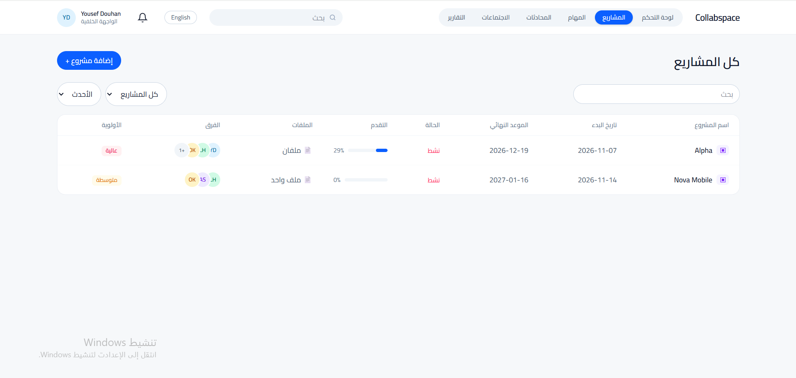

# CollabSpace

A team-collaboration workspace — projects, Kanban tasks, chat, meetings with AI summaries, reports and an AI assistant — built with **Laravel 13** for the Huma-volve CollabSpace challenge (Figma: *Collabpspace, Team C*).

The same business logic powers two front ends:

- a **REST API** (`/api/v1`, Sanctum tokens) with a ready-to-import Postman collection, and
- a **Blade web app** (session auth) that follows the Figma design, in **English and Arabic (RTL)**.

> **بالعربية:** منصة تعاون للفرق، فيها إدارة مشاريع، ولوحة مهام Kanban بالسحب والإفلات، ومحادثات، واجتماعات مع تقويم أسبوعي وملخص بالذكاء الاصطناعي، وتقارير ورسوم بيانية، ومساعد ذكي يجيب من بيانات المشروع. الواجهة تعمل بالعربية والإنجليزية، ويُبدَّل بينهما بزر في الشريط العلوي. البناء بـ Laravel 13، وفيه REST API موثّق وواجهة Blade، و91 اختباراً آلياً.


---

## Features

| Area | What you can do |
|---|---|
| **Dashboard** | Task stats with month-over-month change, 6-month project chart, active projects, recent files, priority tasks, team workload, upcoming meetings, quick Ask AI |
| **Projects** | Create projects, filter and sort them, track completion %, manage members and roles (owner / manager / member), edit a Markdown wiki |
| **Tasks** | Kanban board (To-do → In Progress → In Review → Completed) with drag & drop, priorities, tracks, assignees and a reviewer, progress, due dates with overdue highlighting, comments, attachments |
| **Files** | Private uploads per project or task, downloads only for members (files are never public) |
| **Chats** | Direct messages and group or project channels, attachments, edit and delete your own messages, read receipts (✓ / ✓✓), unread counters, pin and archive per user |
| **Meetings** | Weekly calendar, scheduling with attendees, Accept or Decline, reminders, shared notes, comments, attachments, transcript search, **AI summary and key points** generated from the transcript |
| **Reports** | KPIs (task completion, project completion, team activity), charts, per-project and per-member tables, saved reports, CSV export |
| **Ask AI** | A chat assistant that answers from the user's **own visible data** (projects, tasks, meetings), in English or Arabic |
| **Notifications** | Task assigned, task overdue, meeting invitation and meeting reminder, both in-app and through the API |
| **Profiles** | Member pages (completed tasks, hours worked, recent activity), settings, avatar, password change |
| **i18n** | Full Arabic translation and right-to-left layout, Arabic dates and validation messages; the API honours `Accept-Language: ar` |

### Screenshots

| Kanban (Arabic, RTL) | Meeting with AI summary |
|---|---|
|  |  |
| **Weekly calendar** | **Reports** |
|  |  |
| **Ask AI** | **Projects** |
|  |  |

---

## Tech stack

- **Backend:** PHP 8.3+ (tested on 8.4), Laravel 13, Sanctum 4, MySQL / MariaDB (SQLite for tests)
- **Frontend:** Blade components, Tailwind CSS 4, Alpine.js, SortableJS (Kanban), Chart.js, Vite 8
- **AI:** pluggable provider — Google Gemini (default), OpenAI or Anthropic — called over plain HTTP

---

## Getting started

### Requirements

PHP 8.3+, Composer 2, Node 20+ and npm, and MySQL 8 or MariaDB 10.6+.

### Installation

```bash
git clone https://github.com/Yousef-Douhan/collabspace.git
cd collabspace

composer install
npm install

cp .env.example .env
php artisan key:generate
```

Set your database in `.env`:

```env
DB_CONNECTION=mysql
DB_DATABASE=collabspace
DB_USERNAME=root
DB_PASSWORD=
```

Then create the tables and the demo data, and build the assets:

```bash
php artisan migrate --seed
php artisan storage:link
npm run build
php artisan serve
```

Open <http://127.0.0.1:8000>.

During development, run `npm run dev` next to `php artisan serve` so CSS and JS changes appear instantly.

### Demo accounts

All demo accounts use the password **`password`**.

| Email | Role |
|---|---|
| `admin@collabspace.test` | Admin (Yousef Douhan, Team Lead): sees every project |
| `lina@collabspace.test` | Manager (UI/UX Designer) |
| `omar@collabspace.test` | Member (Frontend Developer) |
| `sara@collabspace.test` | Member (Backend Developer) |
| `ahmad@collabspace.test` | Member (Graphic Designer) |

The seeder creates 2 projects, 9 tasks (one of them overdue), real files, 3 conversations and a meeting with a transcript, so every screen has data.

### AI setup (optional)

Ask AI and meeting summaries need an API key. Everything else works without one. Add these lines to `.env`:

```env
AI_PROVIDER=gemini          # gemini | openai | anthropic
AI_API_KEY=your-key-here
AI_MODEL=                   # optional; defaults to gemini-3.5-flash for Gemini
```

A free Gemini key is available from [Google AI Studio](https://aistudio.google.com/). Never commit `.env`.

### Scheduled jobs

Meeting reminders run every minute, and overdue-task notifications run daily at 09:00:

```bash
php artisan schedule:work      # development
```

In production, add a cron entry that runs `php artisan schedule:run` every minute.

---

## Tests

```bash
php artisan test
```

**91 tests, all passing.** They run on in-memory SQLite and fake every AI call, so no API key or database setup is needed.

| Suite | Covers |
|---|---|
| `tests/Feature/Api/*` | Auth, projects, members, tasks and Kanban ordering, files, chats and receipts, meetings and reminders, AI, notifications, dashboard, reports, search, permissions |
| `tests/Feature/Web/WebPagesTest` | Every Blade page renders; login and logout; Kanban move; forms; access control |
| `tests/Feature/Web/LocaleTest` | Language switching, Arabic RTL on every page, Arabic validation, API `Accept-Language` |
| `tests/Feature/DatabaseSeederTest` | The demo data is consistent |

---

## REST API

- **Base URL:** `/api/v1`
- **Authentication:** `Authorization: Bearer <token>`. Get a token from `POST /api/v1/auth/login`.
- **Postman:** import [`docs/postman/CollabSpace.postman_collection.json`](docs/postman/CollabSpace.postman_collection.json). It has 71 requests. The **Login** request saves the token automatically, and the IDs are kept in collection variables, so you can run the requests in order.
- **Full endpoint list and database schema:** [`docs/DESIGN.md`](docs/DESIGN.md).

Main groups: `auth`, `profile`, `users`, `projects` (members, wiki), `tasks` (board, move, reviewer, comments), `files`, `conversations` (messages, read, pin and archive), `meetings` (RSVP, notes, attachments, AI summary), `notifications`, `ai/ask`, `dashboard`, `reports` (+ CSV), `search`, `meta`.

Errors are always JSON: `401`, `403`, `404`, `422` with field errors, and `503` for AI failures.

---

## Architecture

```
HTTP (API controllers  |  Web controllers)
        │                      │
        ├──── Form Requests ───┤   validation (shared)
        ├──── Policies ────────┤   authorization (shared)
        ▼                      ▼
              Services                business logic (shared)
   ProjectService · TaskService · FileService · ChatService
   MeetingService · DashboardService · ReportService
   AiService (provider-agnostic) · AiAssistant · ActivityLogger
        │
     Eloquent models + visibleTo() scopes  →  MySQL
```

- **Thin controllers.** API and web controllers only translate HTTP into a Service call. Both front ends share the same validation, authorization and logic, so they can't drift apart.
- **Visibility in one place.** `Project::visibleTo($user)` (and the matching scopes on tasks, files and meetings) is the single rule for what a user can see. The AI assistant reads its context through the same scopes, so it can never leak another team's data.
- **Kanban ordering.** Positions stay contiguous inside each column. Moving a card re-numbers both columns in a single transaction.
- **Private files.** Uploads go to the non-public `local` disk and are streamed only after a policy check.
- **Typed domain.** PHP backed enums (status, priority, track, roles) with translated labels.
- **Localization.** `SetLocale` middleware picks the language in this order: API `Accept-Language`, then the session, then the user's saved locale. Translations live in `lang/ar.json` and `lang/ar/*.php`, and the layout switches `dir="rtl"` and the Arabic font.

### Project layout

```
app/
  Enums/                 status, priority, track, roles… (+ EnumHelpers)
  Http/Controllers/Api/V1/   REST controllers
  Http/Controllers/Web/      Blade controllers
  Http/Middleware/SetLocale.php
  Http/Requests/         Form Requests (shared)
  Http/Resources/        API Resources
  Models/  Policies/  Services/  Notifications/  Console/Commands/
lang/ar.json, lang/ar/   Arabic translations
resources/views/         Blade pages and components (layouts, modal, stat-card, avatar…)
resources/js/app.js      Alpine components: kanban (SortableJS), chart (Chart.js)
docs/                    DESIGN.md, UI_SPEC.md, Postman collection, screenshots
tests/Feature/           Api/, Web/
```

---

## Author

**Yousef Douhan**, Backend Developer (Laravel) · [GitHub](https://github.com/Yousef-Douhan)

Built for the Huma-volve CollabSpace challenge, November 2026.
